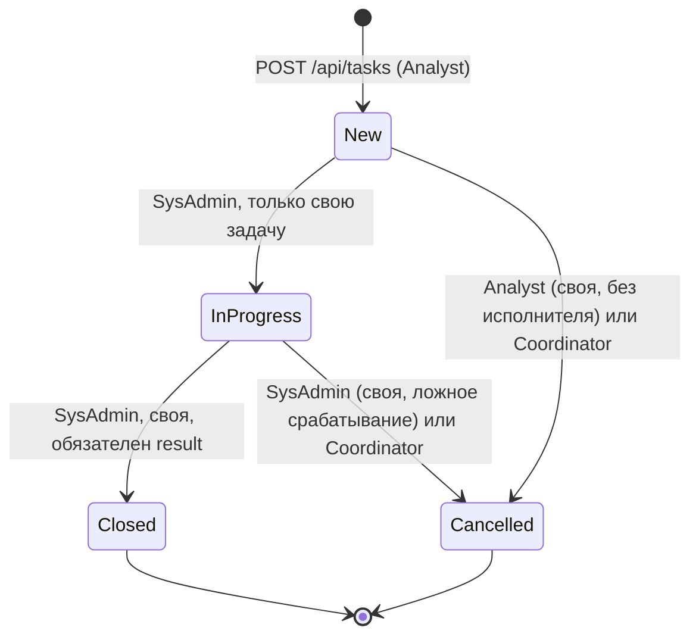

# Контракт API

Курс: Б1.В.ДЭ.01.02.02 · КГЭУ · семестр 1 · 2026/2027  
Студент: Огурцов Егор Алексеевич · Группа: ТРИС-3-23 · ЛР2

Связанные документы: [модель данных](data-model.md) · [матрица](requirements-matrix.md) · [архитектура](architecture.md)

Базовый адрес в разработке: `http://localhost:5000`. Формат тел — JSON. Имена полей совпадают с [моделью данных](data-model.md).

---

## 1. Задачи — основная таблица

| Метод и путь | Тело запроса | Успех | Возможные ошибки | Кто может |
|--------------|--------------|-------|------------------|-----------|
| `GET /api/tasks` | — | `200`, массив задач или `[]` | `401` | все роли (сервер сам фильтрует: аналитик — свои, исполнитель — назначенные на него, координатор — все) |
| `GET /api/tasks/{id}` | — | `200`, одна задача | `401`, `403`, `404` | автор, исполнитель, координатор |
| `POST /api/tasks` | `title`, `serviceAccountId`, `description` | `201`, задача с `id`, `number`, `status: "New"` | `400`, `401`, `403` | `Analyst` |
| `PATCH /api/tasks/{id}/assignee` | `assigneeUserId`, `dueDate` | `200`, задача с исполнителем | `400`, `401`, `403`, `404`, `409` | `Coordinator` |
| `PATCH /api/tasks/{id}/status` | `status`, `result` (только для `Closed`) | `200`, задача с новым статусом | `400`, `401`, `403`, `404`, `409` | по таблице переходов (§3) |

Метода удаления нет: задача не стирается, отмена — это `PATCH …/status` со значением `Cancelled`, строка остаётся в базе. Действие задаёт HTTP-метод (`POST` — создать), а не глагол в пути, поэтому путь создания — просто `/api/tasks`.

Назначение исполнителя и смена статуса — **два разных** `PATCH`: координатор назначает и не может случайно поменять статус, исполнитель меняет статус и не может переназначить задачу. Так правила ролей из ЛР1 проверяются на сервере по одному адресу на одно действие.

Фильтры списка для координатора (ФТ-4): `GET /api/tasks?status=InProgress`, `GET /api/tasks?overdue=true`. Без параметров — все задачи. Пустой результат — `200` и `[]`, а не `404`.

## 2. Вспомогательные запросы

| Метод и путь | Тело | Успех | Ошибки | Зачем |
|--------------|------|-------|--------|-------|
| `POST /api/auth/login` | `login`, `password` | `200`, текущий пользователь | `400`, `401` | экран входа |
| `POST /api/auth/logout` | — | `204` | — | выход |
| `GET /api/auth/me` | — | `200`, текущий пользователь | `401` | кто вошёл, какая роль |
| `GET /api/service-accounts` | — | `200`, массив или `[]` | `401` | выпадающий список при создании задачи |
| `GET /api/users?role=SysAdmin` | — | `200`, массив или `[]` | `401`, `403` | выпадающий список исполнителей у координатора |

Справочник учётных записей в семестре только читается (заполняется seed-данными), поэтому `POST`/`PATCH` для него не планируются.

## 3. Статусы и переходы

Только четыре кода: `New`, `InProgress`, `Closed`, `Cancelled`. Подписи на экране — в [модели данных](data-model.md#1-словарь-проекта).



| Переход | Кто | Условие | Иначе |
|---------|-----|---------|-------|
| `New` → `InProgress` | `SysAdmin` | он исполнитель этой задачи | чужая задача → `403` |
| `New` → `Cancelled` | `Analyst` | он автор, `assigneeUserId = null` | чужая → `403`, уже назначена → `409` |
| `New` → `Cancelled` | `Coordinator` | — | — |
| `InProgress` → `Closed` | `SysAdmin` | он исполнитель, `result` не пустой | нет `result` → `400` |
| `InProgress` → `Cancelled` | `SysAdmin` или `Coordinator` | исполнитель — только свою | чужая → `403` |
| любой другой (например, `Closed` → `InProgress`, `New` → `Closed`) | — | — | `409` |

`Closed` и `Cancelled` — конечные статусы.

## 4. Коды ответов

| Код | Когда |
|-----|-------|
| `200` | успешное чтение или изменение |
| `201` | задача создана; в заголовке `Location: /api/tasks/{id}` |
| `204` | успех без тела (выход) |
| `400` | прислали некорректные данные: короткий заголовок, нет `serviceAccountId`, неизвестный статус, нет `result` при закрытии |
| `401` | пользователь не вошёл (ФТ-11) |
| `403` | вошёл, но роль или «чужая задача» не позволяют (ФТ-10, критерий 3) |
| `404` | задачи с таким `id` нет (или учётной записи / пользователя, на которого ссылаются) |
| `409` | запрос корректный, но так нельзя по правилам процесса: недопустимый переход статуса, назначение не на `New`, автор назначается исполнителем (ФТ-12) |

Ошибки возвращаются в стандартном для ASP.NET Core формате `ProblemDetails`.

---

## 5. Примеры JSON

### 5.1. Создание задачи — `POST /api/tasks`

Запрос (клиент **не** присылает `id`, `number`, `status`, `createdByUserId`, `assigneeUserId`):

```json
{
  "title": "Бессрочный пароль у svc_backup",
  "serviceAccountId": 3,
  "description": "Пароль не менялся с 2021 года, флаг PasswordNeverExpires. Сменить пароль и перевести учётку на gMSA."
}
```

Ответ `201 Created`, заголовок `Location: /api/tasks/14`:

```json
{
  "id": 14,
  "number": "SAR-2026-0014",
  "title": "Бессрочный пароль у svc_backup",
  "description": "Пароль не менялся с 2021 года, флаг PasswordNeverExpires. Сменить пароль и перевести учётку на gMSA.",
  "status": "New",
  "serviceAccountId": 3,
  "serviceAccountName": "svc_backup",
  "createdByUserId": 2,
  "createdByName": "Иванова А. С.",
  "assigneeUserId": null,
  "assigneeName": null,
  "dueDate": null,
  "result": null,
  "createdAt": "2026-10-09T08:15:00Z",
  "updatedAt": "2026-10-09T08:15:00Z"
}
```

`serviceAccountName`, `createdByName`, `assigneeName` — только для отображения: сервер берёт их JOIN-ом из `service_accounts` и `users` при чтении, в таблице `risk_tasks` они **не хранятся** (см. 3НФ в [модели данных](data-model.md#4-проверка-3нф)).

Ответ `400 Bad Request` (заголовок короче 5 символов):

```json
{
  "type": "https://tools.ietf.org/html/rfc9110#section-15.5.1",
  "title": "One or more validation errors occurred.",
  "status": 400,
  "errors": {
    "title": ["Заголовок должен содержать от 5 до 80 символов."]
  }
}
```

### 5.2. Список задач — `GET /api/tasks`

Ответ `200 OK`:

```json
[
  {
    "id": 14,
    "number": "SAR-2026-0014",
    "title": "Бессрочный пароль у svc_backup",
    "status": "New",
    "serviceAccountId": 3,
    "serviceAccountName": "svc_backup",
    "assigneeUserId": null,
    "assigneeName": null,
    "dueDate": null
  }
]
```

Если задач нет — `200 OK` и `[]`.

### 5.3. Одна задача — `GET /api/tasks/{id}`

Ответ `200 OK` — тот же объект, что в 5.1. Ответ `404 Not Found`, если `GET /api/tasks/999`:

```json
{
  "type": "https://tools.ietf.org/html/rfc9110#section-15.5.5",
  "title": "Not Found",
  "status": 404,
  "detail": "Задача с id = 999 не найдена."
}
```

### 5.4. Назначение исполнителя — `PATCH /api/tasks/{id}/assignee`

Запрос координатора:

```json
{
  "assigneeUserId": 5,
  "dueDate": "2026-10-20"
}
```

Ответ `200 OK` — задача целиком, изменились только `assigneeUserId`, `assigneeName`, `dueDate`, `updatedAt`. **Статус остаётся `New`** (критерий 2):

```json
{
  "id": 14,
  "number": "SAR-2026-0014",
  "status": "New",
  "assigneeUserId": 5,
  "assigneeName": "Петров И. В.",
  "dueDate": "2026-10-20",
  "updatedAt": "2026-10-09T09:02:00Z"
}
```

(в примере сокращён — остальные поля как в 5.1)

Ошибки:

- `404` — задачи `14` нет или пользователя `5` нет;
- `409` — задача уже не в статусе `New`; пользователь `5` не `SysAdmin`; пользователь `5` — автор задачи (ФТ-12);
- `400` — нет `assigneeUserId` или `dueDate` в прошлом;
- `403` — запрос прислал не координатор.

```json
{
  "type": "https://tools.ietf.org/html/rfc9110#section-15.5.10",
  "title": "Conflict",
  "status": 409,
  "detail": "Автор задачи не может быть назначен её исполнителем."
}
```

### 5.5. Смена статуса — `PATCH /api/tasks/{id}/status`

Взять в работу (исполнитель, критерий 3):

```json
{
  "status": "InProgress"
}
```

Ответ `200 OK`:

```json
{
  "id": 14,
  "number": "SAR-2026-0014",
  "status": "InProgress",
  "assigneeUserId": 5,
  "updatedAt": "2026-10-10T07:30:00Z"
}
```

(в примере сокращён — остальные поля как в 5.1)

Закрыть (результат обязателен):

```json
{
  "status": "Closed",
  "result": "Учётка переведена на gMSA svc_backup$, старый пароль отозван, флаг PasswordNeverExpires снят."
}
```

Ошибки:

- `403` — задачу двигает не её исполнитель (другой `SysAdmin` или аналитик):

```json
{
  "type": "https://tools.ietf.org/html/rfc9110#section-15.5.4",
  "title": "Forbidden",
  "status": 403,
  "detail": "Менять статус может только назначенный исполнитель задачи."
}
```

- `409` — недопустимый переход, например `Closed` → `InProgress`:

```json
{
  "type": "https://tools.ietf.org/html/rfc9110#section-15.5.10",
  "title": "Conflict",
  "status": 409,
  "detail": "Переход из статуса Closed в InProgress запрещён."
}
```

- `400` — `"status": "Done"` (неизвестный код) или `Closed` без `result`;
- `404` — задачи нет.
