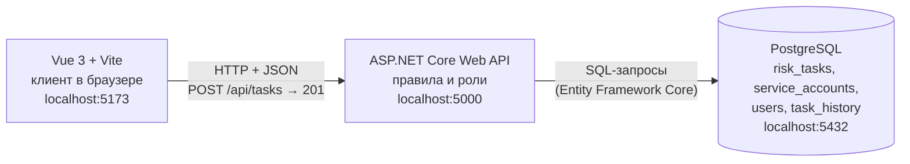

# Архитектура

Курс: Б1.В.ДЭ.01.02.02 · КГЭУ · семестр 1 · 2026/2027  
Студент: Огурцов Егор Алексеевич · Группа: ТРИС-3-23 · ЛР2

Связанные документы: [модель данных](data-model.md) · [API](api-contract.md) · [матрица](requirements-matrix.md)

---

## 1. Схема из трёх узлов



Та же схема текстом:

```text
 Vue 3 + Vite               ASP.NET Core Web API           PostgreSQL
 localhost:5173  ─────────► localhost:5000   ─────────────► localhost:5432
                   HTTP                        запросы к БД
       POST /api/tasks                         INSERT INTO risk_tasks ...
       { title, serviceAccountId,
         description }
       ◄── 201 { id, number, status: "New" }
```

**Подпись: архитектура web-ИС семестра** — три узла, две связи, один источник правды о задачах по устранению рисков. Браузер обращается только к API, к базе обращается только API. Прямой связи браузера с PostgreSQL нет.

---

## 2. Кто за что отвечает

| Узел | Порт | Что делает | Чего не делает |
|------|------|------------|----------------|
| Vue 3 + Vite | `5173` | три экрана (вход, список, создание), формы, подписи статусов на русском, отправка HTTP-запросов | не хранит данные, не решает, кому что можно |
| ASP.NET Core | `5000` | проверяет вход и роль, валидирует поля, проверяет переходы статусов, присваивает `id`, `number`, `status`, пишет историю | не рисует экраны |
| PostgreSQL | `5432` | хранит строки таблиц, ключи PK/FK, уникальность `number`, `sam_account_name`, `login` | не доступна из браузера |

## 3. Один запрос целиком (критерий 1)

1. Аналитик ИБ на экране «Создать задачу» заполняет форму и нажимает «Создать».
2. Vue отправляет `POST http://localhost:5000/api/tasks` с телом:
   ```json
   { "title": "Бессрочный пароль у svc_backup", "serviceAccountId": 3, "description": "Пароль не менялся с 2021 года. Сменить и перевести на gMSA." }
   ```
3. ASP.NET Core проверяет: пользователь вошёл (`401`), роль `Analyst` (`403`), длины полей (`400`), учётка `3` существует (`404`).
4. Сервер выставляет `status = New`, `createdByUserId` = текущий пользователь, `assigneeUserId = null`, генерирует `number = SAR-2026-0014` и пишет строку в `risk_tasks` и запись `Created` в `task_history`.
5. PostgreSQL возвращает `id = 14`.
6. API отвечает `201 Created` с задачей; Vue показывает её в списке со статусом «Зарегистрирована».

## 4. Почему браузер не ходит в PostgreSQL напрямую

- Для этого пришлось бы отдать в браузер логин и пароль от базы — их увидит любой пользователь через DevTools.
- Правила ЛР1 (кто создаёт, кто назначает, исполнитель двигает только свою задачу, автор не исполнитель) проверяет сервер. Клиент с прямым доступом к базе обошёл бы их одним `UPDATE`.
- Номер `SAR-2026-NNNN`, статус `New` и история изменений должны ставиться в одном месте, иначе два браузера выдадут одинаковые номера.
- Все пользователи видят одни и те же данные, потому что правда лежит на сервере, а не в каждом браузере.

## 5. Воспроизводимый запуск (план)

Код появится в следующих ЛР в этом же репозитории. Запуск будет описан в README: поднять PostgreSQL на `5432`, запустить API на `5000` (миграции и seed-данные справочника применяются при старте), запустить Vue на `5173`. Строка подключения к БД хранится только на сервере (в конфигурации ASP.NET Core), а не в коде клиента.
