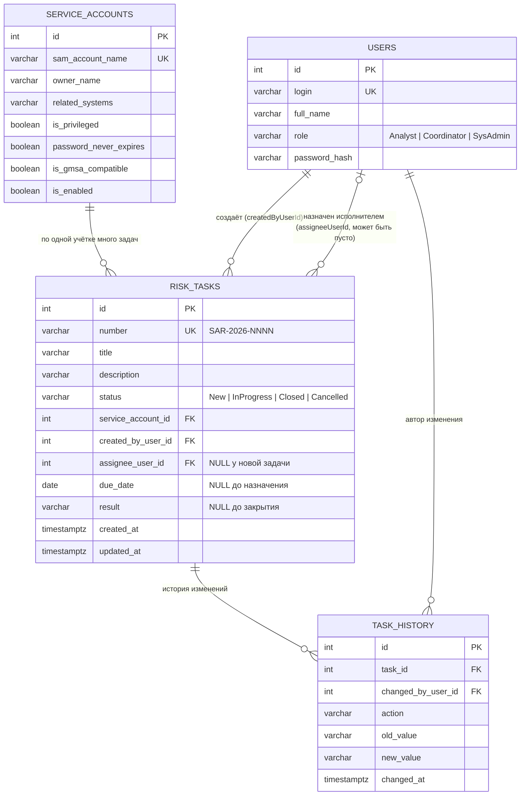

# Модель данных

Курс: Б1.В.ДЭ.01.02.02 · КГЭУ · семестр 1 · 2026/2027  
Студент: Огурцов Егор Алексеевич · Группа: ТРИС-3-23 · ЛР2

Связанные документы: [требования ЛР1](lab-01-requirements.md) · [API](api-contract.md) · [матрица](requirements-matrix.md) · [архитектура](architecture.md)

---

## 1. Словарь проекта

Эти имена дальше без изменений идут в Vue, C# и SQL.

| Термин курса | Термин моей темы | Сущность (C#) | Таблица (SQL) | Путь API |
|--------------|------------------|---------------|---------------|----------|
| Ticket | задача по устранению риска | `RiskTask` | `risk_tasks` | `/api/tasks` |
| Site | сервисная учётная запись AD | `ServiceAccount` | `service_accounts` | `/api/service-accounts` |
| User | аналитик ИБ / координатор / системный администратор | `User` | `users` | `/api/users` |
| `siteId` | ссылка на учётную запись | `serviceAccountId` | `service_account_id` | — |
| `number` | номер задачи | `number` (`SAR-2026-0001`) | `number` | — |

> Почему сущность называется `RiskTask`, а не просто `Task`: в C# имя `Task` уже занято
> (`System.Threading.Tasks.Task`, на нём построены все async-методы ASP.NET Core).
> Путь API остаётся `/api/tasks`, как в ЛР1; в JSON поля те же, что в таблице ниже.

Роли пользователей (код в БД и API → подпись на экране):

| Код | На экране |
|-----|-----------|
| `Analyst` | Аналитик ИБ |
| `Coordinator` | Координатор |
| `SysAdmin` | Системный администратор |

Статусы задачи (код в БД и API → подпись на экране):

| Код | На экране |
|-----|-----------|
| `New` | Зарегистрирована |
| `InProgress` | В работе |
| `Closed` | Риск устранён |
| `Cancelled` | Отменена |

Уровни риска сервисной учётной записи (код в API → подпись на экране), правило расчёта — в [2.5](#25-уровень-риска-учётной-записи-вычисляется-не-хранится):

| Код | На экране |
|-----|-----------|
| `Low` | Низкий |
| `Medium` | Средний |
| `High` | Высокий |

---

## 2. Сущности и поля

### 2.1. RiskTask — задача по устранению риска (главный объект)

| Поле (JSON / C#) | Колонка БД | Тип | Ключ | Обяз. | Кто заполняет | Описание |
|------------------|------------|-----|------|-------|---------------|----------|
| `id` | `id` | integer | **PK** | да | сервер | машинный ключ, используется в адресе `/api/tasks/{id}` |
| `number` | `number` | varchar(20), unique | | да | сервер | человеческий номер `SAR-2026-0001` |
| `title` | `title` | varchar(80) | | да | аналитик | суть риска, 5–80 символов |
| `description` | `description` | varchar(500) | | да | аналитик | описание риска и мероприятий, 10–500 символов |
| `status` | `status` | varchar(20) | | да | сервер / PATCH | только `New`, `InProgress`, `Closed`, `Cancelled` |
| `serviceAccountId` | `service_account_id` | integer | **FK** → `service_accounts.id` | да | аналитик | к какой учётной записи относится риск |
| `createdByUserId` | `created_by_user_id` | integer | **FK** → `users.id` | да | сервер | автор задачи (текущий пользователь) |
| `assigneeUserId` | `assignee_user_id` | integer | **FK** → `users.id` | **нет** | координатор | исполнитель; у новой задачи пусто (`null`) |
| `dueDate` | `due_date` | date | | нет | координатор | срок, ставится вместе с назначением |
| `result` | `result` | varchar(1000) | | нет | исполнитель | результат выполнения, обязателен при `Closed` |
| `createdAt` | `created_at` | timestamptz | | да | сервер | когда создана |
| `updatedAt` | `updated_at` | timestamptz | | да | сервер | когда менялась последний раз |

### 2.2. ServiceAccount — сервисная учётная запись AD (справочник)

| Поле (JSON / C#) | Колонка БД | Тип | Ключ | Обяз. | Описание |
|------------------|------------|-----|------|-------|----------|
| `id` | `id` | integer | **PK** | да | машинный ключ |
| `samAccountName` | `sam_account_name` | varchar(64), unique | | да | логин учётки в AD, например `svc_backup` — это и есть «название» справочника |
| `ownerName` | `owner_name` | varchar(150) | | нет | ФИО владельца из AD; пусто = «ничейная» учётка (это и есть риск) |
| `relatedSystems` | `related_systems` | varchar(300) | | нет | связанные системы (например, «1С, СУБД бухгалтерии») |
| `isPrivileged` | `is_privileged` | boolean | | да | состоит в привилегированных группах |
| `passwordNeverExpires` | `password_never_expires` | boolean | | да | бессрочный пароль |
| `isGmsaCompatible` | `is_gmsa_compatible` | boolean | | да | можно перевести на gMSA |
| `isEnabled` | `is_enabled` | boolean | | да | учётка включена в AD |

В семестре справочник заполняется тестовыми данными (seed); импорт из AD — запас под ВКР.
`ownerName` — атрибут самой учётки в AD, а не пользователь системы: владелец мог уволиться и в нашей системе не работает, поэтому это не FK на `users`.
Из признаков `ownerName`, `passwordNeverExpires`, `isPrivileged` сервер вычисляет уровень риска учётки — см. [2.5](#25-уровень-риска-учётной-записи-вычисляется-не-хранится).

### 2.3. User — пользователь системы

| Поле (JSON / C#) | Колонка БД | Тип | Ключ | Обяз. | Описание |
|------------------|------------|-----|------|-------|----------|
| `id` | `id` | integer | **PK** | да | машинный ключ (не фамилия и не логин) |
| `login` | `login` | varchar(50), unique | | да | логин для входа |
| `fullName` | `full_name` | varchar(150) | | да | ФИО, показывается в списках |
| `role` | `role` | varchar(20) | | да | `Analyst`, `Coordinator` или `SysAdmin` |
| — | `password_hash` | varchar | | да | только хэш (НФТ-3), в API **никогда** не отдаётся |

### 2.4. TaskHistory — история изменений (под НФТ-5)

| Поле (JSON / C#) | Колонка БД | Тип | Ключ | Описание |
|------------------|------------|-----|------|----------|
| `id` | `id` | integer | **PK** | машинный ключ |
| `taskId` | `task_id` | integer | **FK** → `risk_tasks.id` | к какой задаче запись |
| `changedByUserId` | `changed_by_user_id` | integer | **FK** → `users.id` | кто изменил |
| `action` | `action` | varchar(20) | | `Created`, `Assigned` или `StatusChanged` |
| `oldValue` | `old_value` | varchar(50) | | было (например, `New`) |
| `newValue` | `new_value` | varchar(50) | | стало (например, `InProgress`) |
| `changedAt` | `changed_at` | timestamptz | | когда |

История пишется сервером автоматически при `POST` и обоих `PATCH`; отдельного запроса на запись нет.

### 2.5. Уровень риска учётной записи (вычисляется, не хранится)

Под ФТ-13. Это не отдельная таблица и не колонки в БД, а два поля, которые сервер добавляет к `ServiceAccount` при чтении справочника.

| Поле (JSON) | Колонка БД | Тип | Описание |
|-------------|------------|-----|----------|
| `riskLevel` | — (не хранится) | string | `Low`, `Medium` или `High` |
| `riskFactors` | — (не хранится) | string[] | коды сработавших факторов; `[]` — факторов нет |

**Факторы риска** — каждый привязан к одному полю `ServiceAccount`:

| Код фактора | На экране | Срабатывает, если |
|-------------|-----------|-------------------|
| `NoOwner` | Нет владельца | `ownerName` пустой (`null` или только пробелы) |
| `PasswordNeverExpires` | Бессрочный пароль | `passwordNeverExpires = true` |
| `Privileged` | Привилегированная учётная запись | `isPrivileged = true` |

**Правило определения уровня** — по числу сработавших факторов:

| Сработало факторов | `riskLevel` | На экране |
|--------------------|-------------|-----------|
| 0 | `Low` | Низкий |
| 1 | `Medium` | Средний |
| 2 или 3 | `High` | Высокий |

Примеры:

| Учётка | Владелец | Бессрочный пароль | Привилегированная | Факторы | Уровень |
|--------|----------|-------------------|-------------------|---------|---------|
| `svc_sql_1c` | Смирнов П. А. | нет | нет | — | `Low` |
| `svc_web` | Кузнецова Е. В. | да | нет | `PasswordNeverExpires` | `Medium` |
| `svc_backup` | — | да | да | `NoOwner`, `PasswordNeverExpires`, `Privileged` | `High` |

Уточнения:

- `isGmsaCompatible` и `isEnabled` на уровень не влияют: первый подсказывает мероприятие (перевести учётку на gMSA), второй показывает состояние в AD. Отключённая учётка оценивается так же, как включённая: её могут включить обратно.
- Веса факторов, давность смены пароля и другие признаки — запас под ВКР («сложные формулы с весами», заявка §6 п.4 и §7 п.2).
- Уровень считает только сервер. Клиент его не присылает и не вводит вручную; после изменения признаков учётки следующий `GET` сразу вернёт новый уровень.

---

## 3. ER-диаграмма

### Связи словами

- **Одна сервисная учётная запись — много задач.** По учётке `svc_backup` может быть несколько задач (бессрочный пароль, нет владельца, лишние права). У каждой задачи ровно одна учётка (`serviceAccountId` обязателен).
- **Один пользователь создаёт много задач.** У каждой задачи ровно один автор (`createdByUserId`), это аналитик ИБ.
- **Один пользователь может быть назначен исполнителем на много задач.** У задачи **ноль или один** исполнитель: сразу после создания `assigneeUserId = null`, координатор заполняет его отдельным действием.
- **Одна задача — много записей истории.** Каждое создание, назначение и смена статуса дают одну строку `TaskHistory`.

---

## 4. Проверка 3НФ

Логин учётной записи (`samAccountName`) и её атрибуты (владелец, связанные системы, признаки риска) хранятся в сущности `ServiceAccount` один раз. `RiskTask` содержит только внешний ключ `serviceAccountId`. Если учётку переименуют в AD или у неё сменится владелец, меняется одна строка в `service_accounts`, и текст не дублируется в задачах.

То же для пользователей: ФИО автора и исполнителя лежат в `users`, а в задаче хранятся только `createdByUserId` и `assigneeUserId`. Роль пользователя хранится у пользователя, а не в задаче.

Что намеренно **не** хранится в `risk_tasks`: `serviceAccountName`, `ownerName`, `assigneeName`, «уровень риска». Если экрану нужно имя учётки или исполнителя, сервер получает его через JOIN при чтении (см. [API](api-contract.md)), но не записывает в задачу.

Уровень риска не хранится и в `service_accounts`: он целиком определяется тремя полями той же строки (`ownerName`, `passwordNeverExpires`, `isPrivileged`). Отдельная колонка `risk_level` дублировала бы эти данные и после смены владельца или флага пароля начала бы им противоречить. Поэтому сервер вычисляет `riskLevel` при чтении по правилу из [2.5](#25-уровень-риска-учётной-записи-вычисляется-не-хранится).

---

## 5. Правила, которые проверяет сервер

- `id`, `number`, `status`, `createdByUserId`, `createdAt` клиент при создании **не присылает**: их ставит сервер. `id` — машинный ключ для адресов и FK, `number` — номер, который диктуют голосом («задача SAR-2026-0014»). Это разные поля.
- Новая задача всегда получает `status = New` и `assigneeUserId = null`.
- Исполнителем можно назначить только пользователя с ролью `SysAdmin` и не автора задачи (ФТ-12).
- Задачи не удаляются: отмена — это статус `Cancelled`, строка остаётся.
- `riskLevel` и `riskFactors` сервер вычисляет по правилу из 2.5 при каждом чтении справочника; в БД их нет, клиент их не присылает.
