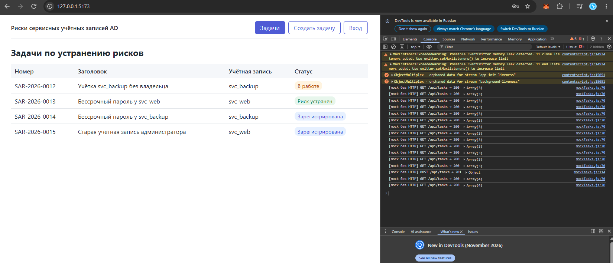
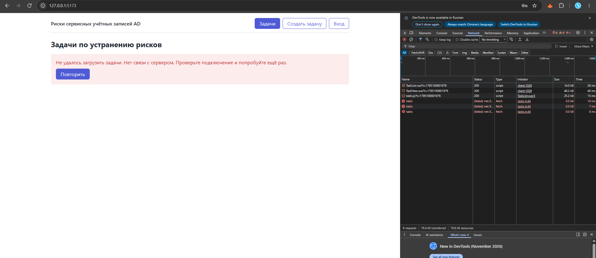

# Отчёт по ЛР6. Vue 3: клиент API и mock

**Студент:** Огурцов Егор Алексеевич, ТРИС-3-23
**Тема:** ИС «Учёт и оценка рисков сервисных учётных записей AD»

## Что сделано

| Файл | Назначение |
|---|---|
| `frontend/.env.example` | Образец настроек: `VITE_API_BASE_URL=http://localhost:5000`. Копируется в `frontend/.env`, сам `.env` в Git не попадает (`.gitignore`) |
| `frontend/src/api/tasks.js` | API-модуль: `getTasks()`, `createTask(body)`, переключатель `USE_MOCK`, классы ошибок `ApiError` (сервер ответил с ошибкой) и `NetworkError` (ответа нет), функция `errorMessage` с текстом для пользователя |
| `frontend/src/api/mockTasks.js` | Заглушка сервера: пауза 500 мс, ответы в формате `{ ok, status, data }`, учебные переключатели `mockSettings.list` и `mockSettings.create` |
| `frontend/src/tasksStore.js` | Общий массив `items`; заполняется ответом `getTasks()` |
| `frontend/src/pages/TaskList.vue` | Состояния `loading` / `empty` / `data` / `error` в одном поле `state`, загрузка в `onMounted`, кнопка «Повторить» |
| `frontend/src/pages/TaskNew.vue` | Отправка через `createTask`, защита от двойного клика (`isSubmitting`), кнопка «Создаём…», разные сообщения об отказах |
| `frontend/src/components/TaskTable.vue` | Имя учётки берётся из ответа (`serviceAccountName`), как будет отдавать сервер |

Страницы не знают, откуда данные: при `USE_MOCK = true` отвечает заглушка, при `false` — настоящий `fetch` к `VITE_API_BASE_URL`. Поля `id`, `number` и `status` новой задачи выдаёт «сервер» (заглушка), страница их не вычисляет.

### Как воспроизвести отказы

В `frontend/src/api/mockTasks.js` поменять значение и сохранить файл (Vite обновит страницу сам):

```js
export const mockSettings = {
  delayMs: 500,
  list: 'ok',   // 'ok' | 'empty' | '500' | 'offline'
  create: 'ok', // 'ok' | '400' | '500' | 'offline'
}
```

Отказ `400` при создании включается переключателем `create: '400'`: форма сама не пропускает короткий заголовок (ЛР5), поэтому до сервера такой запрос из интерфейса не дойдёт. Заглушка при этом проверяет поля так же, как будет проверять сервер.

Настоящую ветку `catch` у `fetch` проверяли так: `USE_MOCK = false`, сервер на порту 5000 не запущен.

## Проверки

### Список задач

| Состояние | Как получить | Что видно |
|---|---|---|
| `loading` | открыть «Задачи» | «Загружаем задачи…» около 0,5 с, таблицы нет |
| `data` | `list: 'ok'` | таблица из трёх задач `SAR-2026-0012…0014` |
| `empty` | `list: 'empty'` | «Задач пока нет. Создать первую задачу», таблицы нет |
| `error` (500) | `list: '500'` | «Не удалось загрузить задачи. Сервер не смог обработать запрос. Попробуйте позже.» + «Повторить» |
| `error` (нет связи) | `list: 'offline'` | «Не удалось загрузить задачи. Нет связи с сервером. Проверьте подключение и попробуйте ещё раз.» + «Повторить» |

После `list: '500'` → переключение на `'ok'` → «Повторить» список загрузился (4 строки). Таблица, загрузка и ошибка ни разу не были видны одновременно.

### Создание задачи

| № | Проверка | Результат |
|---|---|---|
| 1 | Успех + двойной клик по «Создать» | Кнопка заблокирована с текстом «Создаём…»; ушёл **один** POST; в списке одна новая строка `SAR-2026-0015` со статусом «Зарегистрирована»; `id` 15 и номер пришли из ответа |
| 2 | `create: '400'` | «Проверьте поля: сервер не принял данные.»; под заголовком ошибка от сервера «Заголовок должен содержать от 5 до 80 символов.»; поля заполнены; кнопка снова активна |
| 3 | `create: '500'` | «Сервер не смог обработать запрос. Попробуйте позже.»; поля заполнены; кнопка снова активна |
| 4 | `create: 'offline'` | «Нет связи с сервером. Проверьте подключение и попробуйте ещё раз.»; поля заполнены; кнопка снова активна |

### Чеклист отказов

| Отказ | Ветка в коде | Текст пользователю |
|---|---|---|
| `400` | `!ok` → `ApiError(400)` | Проверьте поля: сервер не принял данные. |
| `500` | `!ok` → `ApiError(500)` | Сервер не смог обработать запрос. Попробуйте позже. |
| нет связи | `catch` → `NetworkError` | Нет связи с сервером. Проверьте подключение и попробуйте ещё раз. |

Сетевая ошибка не подменяется кодом 500: у `NetworkError` нет кода ответа, потому что ответа не было.

## Network

Заглушка работает без HTTP, поэтому в Network успешного запроса нет; вместо этого заглушка пишет каждый «ответ» в консоль:

```text
[mock без HTTP] GET /api/tasks → 200 (3 задачи)
[mock без HTTP] POST /api/tasks → 201 {id: 15, number: "SAR-2026-0015", status: "New", …}
[mock без HTTP] GET /api/tasks → 200 (4 задачи)
```

Настоящий `fetch` (`USE_MOCK = false`, сервер не запущен):

| Метод | Адрес | Результат | На странице |
|---|---|---|---|
| GET | `http://localhost:5000/api/tasks` | `net::ERR_CONNECTION_REFUSED` (ответа нет) | «Нет связи с сервером…» |

У GET нет заголовка `Content-Type`, поэтому браузер не отправляет перед ним проверочный запрос `OPTIONS`.

### Скриншоты

- `img/lab-06-success-console.png` — успешное создание, консоль (**mock без HTTP**)
- `img/lab-06-offline-network.png` — отказ «нет связи», вкладка Network





## Ответы на вопросы к защите

1. **Почему ответ `400` не попадает в `catch`?** `fetch` считает запрос успешным, если сервер вообще ответил, — даже с кодом 400 или 500. Исключение он выбрасывает, только когда ответа нет. Поэтому код ответа проверяем сами: `if (!response.ok)` → `ApiError` со статусом.
2. **Чем `500` отличается от отсутствия сети?** При `500` сервер работает и ответил, что не смог обработать запрос (ошибка у него внутри). При отсутствии сети ответа нет совсем: сервер не запущен, неверный адрес или нет связи. Пользователю нужны разные советы: в первом случае — попробовать позже, во втором — проверить подключение.
3. **Откуда берутся `id` и `number`?** Их выдаёт сервер при создании задачи и возвращает в ответе `201`. Клиент их не придумывает: только сервер знает, какие номера уже заняты (сейчас эту роль играет заглушка).
4. **Зачем блокировать кнопку во время POST?** Пока ответа нет, повторный клик отправил бы второй такой же запрос, и появились бы две одинаковые задачи. Флаг `isSubmitting` и `:disabled` не дают отправить форму дважды, а `finally` снимает блокировку при любом исходе.
