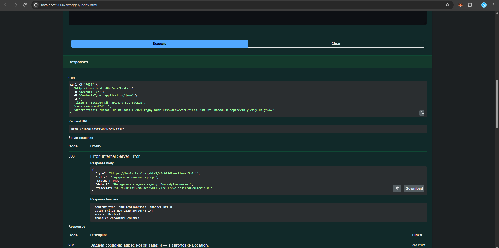
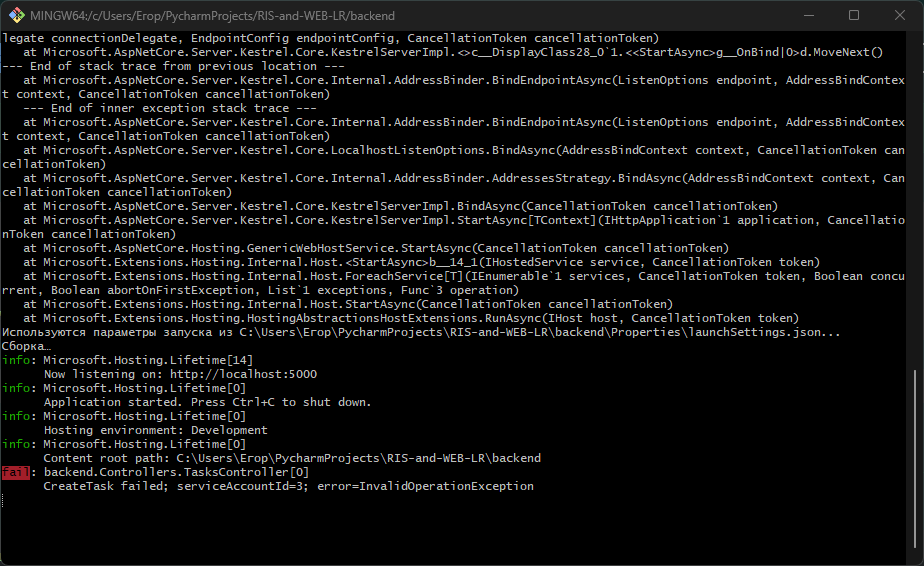

# Отчёт по ЛР8. REST: создание, чтение, назначение и статус

**Студент:** Огурцов Егор Алексеевич, ТРИС-3-23
**Тема:** ИС «Учёт и оценка рисков сервисных учётных записей AD»

## Что сделано

Главный объект системы — **задача по устранению риска** (`RiskTask`), ресурс `/api/tasks`. Имена путей и полей взяты из ЛР2 ([api-contract.md](../api-contract.md), [data-model.md](../data-model.md)) и записаны в README. Учебные имена из методички заменены так: `tickets` → `tasks`, `siteId` → `serviceAccountId`.

| Файл | Назначение |
|---|---|
| `backend/Controllers/TasksController.cs` | принимает HTTP и превращает результат в код ответа |
| `backend/Controllers/ServiceAccountsController.cs` | `GET /api/service-accounts` — справочник учёток с уровнем риска |
| `backend/Dtos/CreateTaskRequest.cs` | тело создания: только `title`, `serviceAccountId`, `description` |
| `backend/Dtos/AssignTaskRequest.cs`, `ChangeTaskStatusRequest.cs` | тела двух `PATCH` |
| `backend/Dtos/TaskResponse.cs`, `ServiceAccountResponse.cs` | что сервер отдаёт клиенту |
| `backend/Models/` | `RiskTask`, `RiskTaskStatus`, `ServiceAccount`, `User`, `RiskAssessment` |
| `backend/Services/TaskService.cs` | правила процесса: переходы статусов, кого можно назначить |
| `backend/Services/RiskCalculator.cs` | расчёт уровня риска учётки (правило из data-model, 2.5) |
| `backend/Data/InMemoryStore.cs` | хранилище в памяти и тестовые данные: 3 учётки, 5 пользователей |
| `docs/api-collection/tasks.postman_collection.json` | коллекция запросов с проверками кодов |

Разделение ролей: **контроллер** принимает HTTP; **сервис** решает, можно ли выполнить действие, и про HTTP не знает. Он возвращает «успех / не найдено / конфликт / неверное поле», а контроллер переводит это в `200` / `404` / `409` / `400`.

## Маршруты

| Метод и путь | Успех | Отказы |
|---|---:|---|
| `POST /api/tasks` | 201 + `Location` | 400 |
| `GET /api/tasks` | 200, в том числе `[]` | — |
| `GET /api/tasks/{id}` | 200 | 404 |
| `PATCH /api/tasks/{id}/assignee` | 200 | 400, 404, 409 |
| `PATCH /api/tasks/{id}/status` | 200 | 400, 404, 409 |
| `GET /api/service-accounts` | 200 | — |

`DELETE` нет: задача отменяется статусом `Cancelled`. Общего `PATCH` «изменить всё» тоже нет: назначение меняет только исполнителя и срок, смена статуса — только статус.

## Правила, которые проверяет сервер

| Правило | Отказ |
|---|---|
| `title` 5–80 символов, `description` 10–500, `serviceAccountId` — целое > 0 | 400 |
| учётная запись с таким `serviceAccountId` существует | 400 (ошибка у поля `serviceAccountId`) |
| `id`, `number`, `status`, автора задаёт сервер; присланные клиентом значения игнорируются | — |
| задача / пользователь с таким `id` существует | 404 |
| в `InProgress` — только если назначен исполнитель | **409** |
| допустимые переходы: `New` → `InProgress`, `New` → `Cancelled`, `InProgress` → `Closed`, `InProgress` → `Cancelled` | 409 для остальных |
| статус — один из `New`, `InProgress`, `Closed`, `Cancelled` | 400 |
| для `Closed` обязателен `result` | 400 |
| исполнителя назначают только задаче в статусе `New`, только `SysAdmin` и не автора | 409 |
| срок `dueDate` не в прошлом | 400 |

Входа в систему пока нет, поэтому сервер не знает, кто прислал запрос: автор новых задач временно — тестовый аналитик Иванова А. С. (`id = 2`). Проверки ролей (`403`) появятся вместе со входом.

## Проверки

### Коллекция запросов

Коллекция `docs/api-collection/tasks.postman_collection.json` прогнана по порядку на только что запущенном сервере (`dotnet run`, `http://localhost:5000`). Номер созданной задачи коллекция запоминает сама (переменная `taskId`).

| № | Запрос | Ожидание | Результат |
|---|---|---:|---|
| 01 | `GET /api/tasks` | 200 | `200`, `[]` |
| 02 | `POST /api/tasks` | 201 | `201`, `id = 1`, `number = SAR-2026-0001`, `status = New`, исполнителя нет, `Location: /api/tasks/1` |
| 03 | `POST` с `title = "Нет"` | 400 | `400`, ошибка у поля `title`: «Заголовок должен содержать от 5 до 80 символов.» |
| 04 | `GET /api/tasks/1` | 200 | `200`, та же задача |
| 05 | `GET /api/tasks/999999` | 404 | `404`, «Задача с id = 999999 не найдена.» |
| 06 | `PATCH …/status` `InProgress` без исполнителя | 409 | `409`, «Нельзя взять задачу в работу, пока не назначен исполнитель.» |
| 07 | `PATCH …/assignee` `5` | 200 | `200`, исполнитель Петров И. В., статус остался `New` |
| 08 | `PATCH …/status` `InProgress` | 200 | `200`, `InProgress`, исполнитель не изменился |
| 09 | `PATCH …/status` `Closed` с `result` | 200 | `200`, `Closed`, результат сохранён |
| 10 | `PATCH …/status` `Closed` → `InProgress` | 409 | `409`, «Переход из статуса Closed в InProgress запрещён.» |
| 11 | `GET /api/service-accounts` | 200 | `200`: `svc_sql_1c` — `Low`, `svc_web` — `Medium`, `svc_backup` — `High` |

Все 11 ожиданий совпали.

### Дополнительные проверки (curl)

| Запрос | Результат |
|---|---|
| `POST` с телом `{}` | `400`, три ошибки сразу: «Укажите заголовок.», «Укажите описание.», «Выберите учётную запись.» |
| `POST` с лишними полями `"id": 77, "status": "Closed", "assigneeUserId": 5` | `201`, сервер выдал свои `id = 2`, `status = New`, исполнителя нет |
| `POST` с `serviceAccountId = 42` | `400`, «Учётная запись с id = 42 не найдена.» |
| `PATCH …/status` `"Done"` | `400`, «Допустимые статусы: New, InProgress, Closed, Cancelled.» |
| `PATCH …/assignee` пользователь `3` (аналитик) | `409`, назначить можно только SysAdmin |
| `PATCH …/assignee` пользователь `99` | `404`, «Пользователь с id = 99 не найден.» |
| `PATCH …/assignee` `dueDate = 2020-01-01` | `400`, «Срок не может быть в прошлом.» |
| `PATCH …/assignee` у задачи в `InProgress` | `409`, назначать можно только задаче в статусе New |
| `PATCH …/status` `Closed` без `result` | `400`, «Чтобы закрыть задачу, опишите результат.» |
| `PATCH …/status` `New` → `Cancelled` | `200` |
| `DELETE /api/tasks/1` | `405 Method Not Allowed` |

### Данные в памяти

После перезапуска сервера список задач снова пустой (`GET /api/tasks` → `[]`), номера начинаются с `SAR-2026-0001`. Для ЛР8 это ожидаемо и написано в README. Хранение в PostgreSQL — ЛР10.

## Лог неожиданной ошибки

Для проверки в `TaskService.Create` после успешной проверки полей временно добавлено исключение. В его текст специально вписаны «путь» и «токен»: `throw new InvalidOperationException(@"Учебный сбой: C:\secret\path, token=abc123")`. Перед коммитом строка удалена.

Метод `Create` перехватывает исключение и делает две вещи:
- пишет в лог одну строку: операция, id учётки и тип ошибки, без тела запроса и stack trace;
- отдаёт клиенту безопасный `ProblemDetails`.

Для остальных адресов то же обеспечивает общий обработчик `app.UseExceptionHandler()`: клиент получает `500` без подробностей.

**Что видит клиент** (Swagger, `POST /api/tasks`): `500`, «Внутренняя ошибка сервера», «Не удалось создать задачу. Попробуйте позже.». В ответе нет stack trace, путей, текста исключения, тела запроса и токена.



**Что видит разработчик** (терминал сервера), последняя строка:

```text
fail: backend.Controllers.TasksController[0]
      CreateTask failed; serviceAccountId=3; error=InvalidOperationException
```



Длинный текст в верхней части скриншота — от предыдущей попытки запуска, когда порт 5000 был занят другим процессом («address already in use»). К проверке сбоя он не относится: строка сбоя — последняя.

## Чеклист методички

**API**

- [x] `POST` создаёт запись и возвращает `201`
- [x] Ответ содержит `id`, `number`, `status: "New"`
- [x] Короткий `title` возвращает `400`
- [x] Несуществующий `id` возвращает `404`
- [x] Нарушение правила процесса возвращает `409`
- [x] Есть два разных `PATCH`
- [x] `DELETE` отсутствует
- [x] Все четыре статуса написаны одинаково: `New`, `InProgress`, `Closed`, `Cancelled`

**Артефакты**

- [x] Коллекция лежит в `/docs/api-collection/`
- [x] В коллекции есть `201`, `400`, `404` и `409`
- [x] README указывает `http://localhost:5000`
- [x] README говорит, что данные пока в памяти
- [x] В отчёте есть доказательство строки лога
- [x] Клиент не получает stack trace
- [x] Изменения добавлены в Git отдельным коммитом
